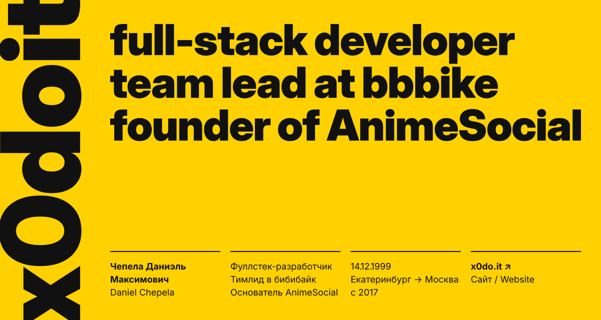
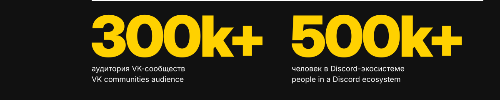
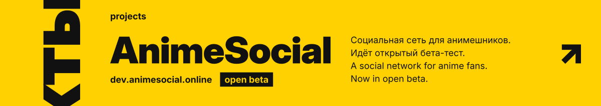

<a href="https://x0do.it"><picture><source media="(max-width: 600px), (min-width: 768px) and (max-width: 900px)" srcset="assets/hero.m.svg"></picture></a> 
<picture><source media="(max-width: 600px), (min-width: 768px) and (max-width: 900px)" srcset="assets/about.m.svg"></picture> 
<picture><source media="(max-width: 600px), (min-width: 768px) and (max-width: 900px)" srcset="assets/stats.m.svg"></picture> 
<a href="https://dev.animesocial.online/"><picture><source media="(max-width: 600px), (min-width: 768px) and (max-width: 900px)" srcset="assets/project-animesocial.m.svg"></picture></a> 
<a href="https://play.animesocial.online/"><picture><source media="(max-width: 600px), (min-width: 768px) and (max-width: 900px)" srcset="assets/project-asoplay.m.svg"></picture></a> 
<a href="https://bb.bike/"><picture><source media="(max-width: 600px), (min-width: 768px) and (max-width: 900px)" srcset="assets/project-bbbike.m.svg"></picture></a> 
<picture><source media="(max-width: 600px), (min-width: 768px) and (max-width: 900px)" srcset="assets/stack.m.svg"></picture> 
<a href="https://x0do.it"><picture><source media="(max-width: 600px), (min-width: 768px) and (max-width: 900px)" srcset="assets/contact-site.m.svg"></picture></a> 
<a href="https://t.me/x0doit"><picture><source media="(max-width: 600px), (min-width: 768px) and (max-width: 900px)" srcset="assets/contact-telegram.m.svg"></picture></a> 
<a href="https://vk.ru/x0doit"><picture><source media="(max-width: 600px), (min-width: 768px) and (max-width: 900px)" srcset="assets/contact-vk.m.svg"></picture></a> 
<a href="mailto:daniel@bb.bike"><picture><source media="(max-width: 600px), (min-width: 768px) and (max-width: 900px)" srcset="assets/contact-mail.m.svg"></picture></a>

Текстовая версия · Text version

### x0doit — Чепела Даниэль Максимович / Daniel Chepela

Full-stack developer · Team lead at bbbike · Founder of AnimeSocial 
14.12.1999 · Екатеринбург → Москва, с 2017

[x0do.it](https://x0do.it) · [t.me/x0doit](https://t.me/x0doit) · [vk.ru/x0doit](https://vk.ru/x0doit) · [daniel@bb.bike](mailto:daniel@bb.bike)

### RU

Фуллстек-разработчик, пишу код под ником x0doit. Делаю веб-сервисы, инструменты и проекты вокруг аниме-сообществ. Работаю тимлидом разработки в кикшеринговом сервисе бибибайк.

Основал AnimeSocial — социальную сеть для анимешников, сейчас идёт открытый бета-тест: [dev.animesocial.online](https://dev.animesocial.online/). Развиваю AsoPlay — стриминговый сервис для просмотра аниме: [play.animesocial.online](https://play.animesocial.online/).

Также занимался крупными VK-сообществами с аудиторией 300k+ и Discord-экосистемой на 500k+ человек.

### EN

Full-stack developer, I write code as x0doit. I build web services, tools and projects around anime communities. I work as a team lead at bbbike, a kicksharing service.

Founder of AnimeSocial, a social network for anime fans, now in open beta: [dev.animesocial.online](https://dev.animesocial.online/). I develop AsoPlay, an anime streaming service: [play.animesocial.online](https://play.animesocial.online/).

I have also worked with VK communities with 300k+ audience and a Discord ecosystem of 500k+ people.

### Проекты · Projects

- [AnimeSocial](https://dev.animesocial.online/) — Социальная сеть для анимешников. Идёт открытый бета-тест. / A social network for anime fans. Now in open beta.
- [AsoPlay](https://play.animesocial.online/) — Стриминговый сервис для просмотра аниме. / An anime streaming service.
- [bbbike](https://bb.bike/) (бибибайк) — Кикшеринговый сервис. Тимлид разработки. / A kicksharing service. Team lead.

### Стек · Stack

<table>
  <tr>
    <th align="left">Languages</th>
    <td>Python · PHP · TypeScript · JavaScript · Dart · Go · SQL · C++ (WinAPI) · Bash · PowerShell</td>
  </tr>
  <tr>
    <th align="left">Backend</th>
    <td>FastAPI · Django · Django REST Framework · Celery · Node.js · Express · Socket.IO · WebSocket</td>
  </tr>
  <tr>
    <th align="left">Frontend</th>
    <td>HTML · CSS · Vanilla JS · jQuery · Vue · Nuxt · MapLibre GL · Leaflet · esbuild</td>
  </tr>
  <tr>
    <th align="left">Mobile</th>
    <td>Flutter · Riverpod · Dio · go_router · flutter_map · Firebase (FCM) · Bluetooth LE · Android · iOS</td>
  </tr>
  <tr>
    <th align="left">Databases</th>
    <td>MySQL · MariaDB · PostgreSQL · PostGIS · Redis · SQLite</td>
  </tr>
  <tr>
    <th align="left">Integrations</th>
    <td>discord.js · DisTube · Telegram Bot API · sherpa-onnx (speech-to-text) · IoT: TCP / BLE</td>
  </tr>
  <tr>
    <th align="left">Infra</th>
    <td>Linux · systemd · Nginx · Apache · Caddy · Docker · OSPanel · aaPanel · Windows</td>
  </tr>
  <tr>
    <th align="left">Testing</th>
    <td>pytest · unittest · node:test · flutter_test</td>
  </tr>
</table>

